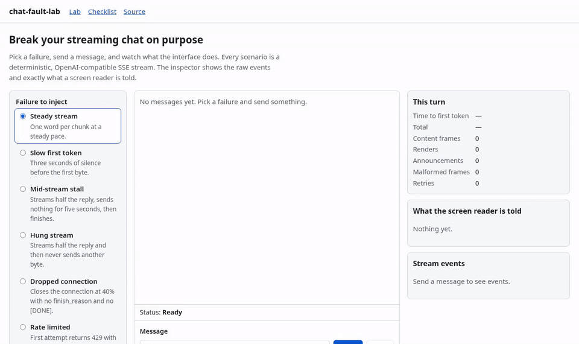
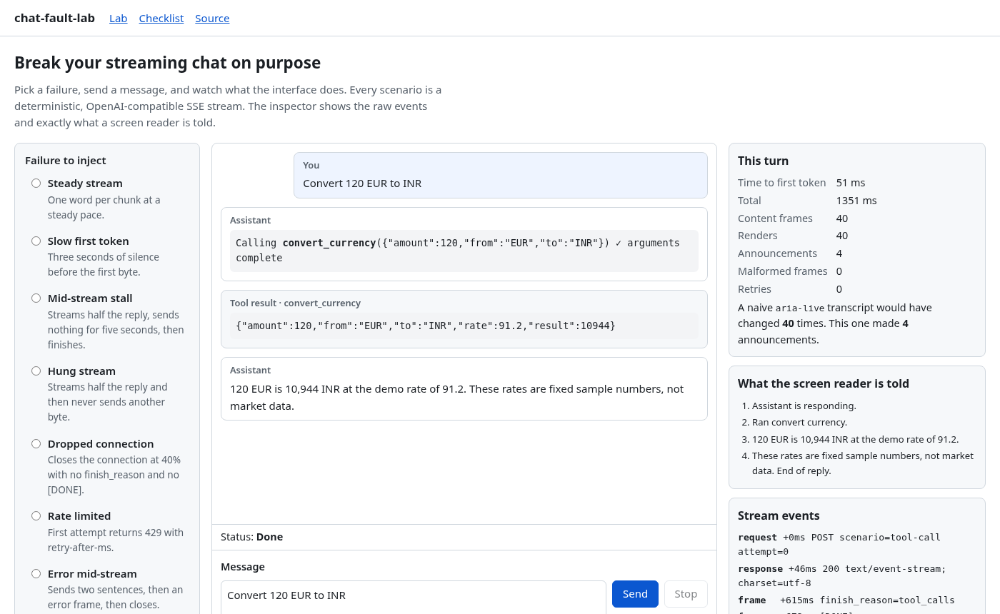
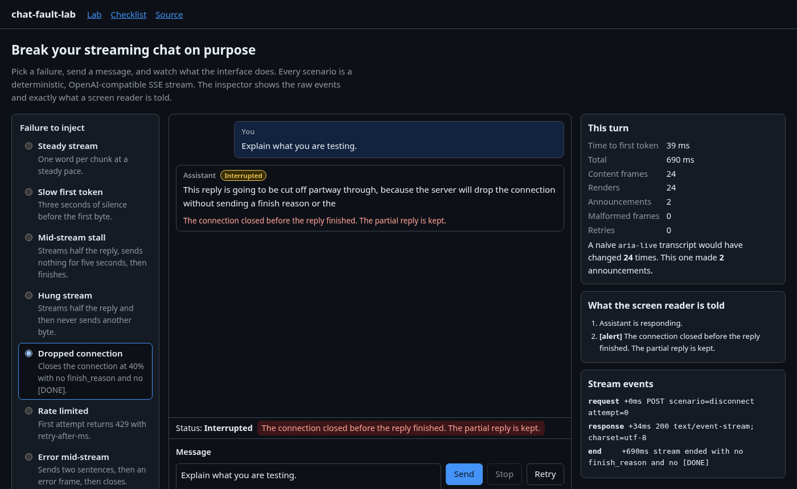
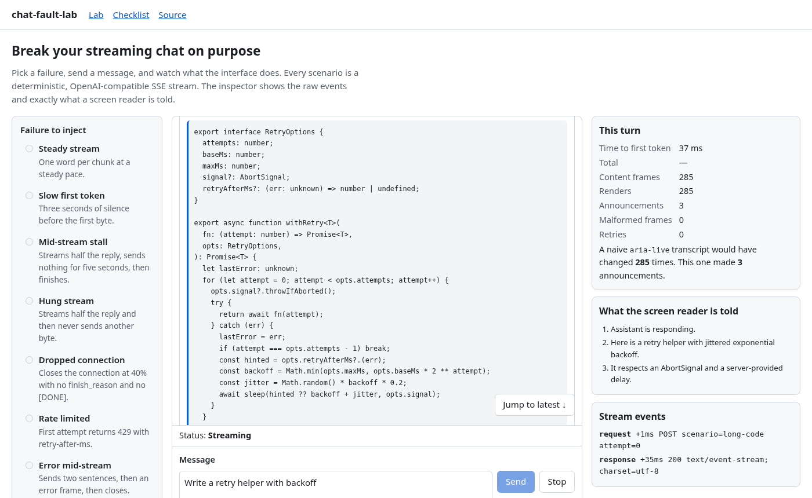

# chat-fault-lab

Break your streaming AI chat on purpose, then prove it survives.

chat-fault-lab is a Next.js app with a fault-injecting, OpenAI-compatible streaming backend and an accessible reference chat UI. Pick a failure (a stalled stream, a dropped connection, a 429, an error frame, a broken frame, UTF-8 split across packets, a streamed tool call), send a message, and watch what the interface does. An inspector shows the raw stream events and exactly what a screen reader is told. Every behaviour is pinned by a Playwright test that runs in a real browser, including axe accessibility checks.

**Live demo:** https://gratycodes.github.io/chat-fault-lab/ (static build; the mock backend runs in your browser, no API key)



## The problem

Streaming chat UIs keep failing in the same few ways, and most of them only show up in a real browser:

- **Screen readers announce every token.** Putting `aria-live` on the node that receives tokens makes NVDA read a stutter of half-words. This shipped in [OpenClaw's Control UI (issue #65538)](https://github.com/openclaw/openclaw/issues/65538), where the reporter called it unusable "until the response is fully complete". The fix took several PRs and landed months later. The [artificia11y streaming pattern](https://artificia11y.ds.house/patterns/dynamic-streaming-output.md) calls it "the single most common way AI interfaces break" for screen reader users, and the [accessibility.build AI chat guide](https://accessibility.build/guides/accessible-ai-chat) lists it first among chat anti-patterns.
- **Auto-scroll fights the reader.** Calling `scrollIntoView` on every token makes it impossible to scroll up mid-reply. A smooth-scroll fix then races its own scroll events and silently stops following. See [trainable PR #152](https://github.com/lucastononro/trainable/pull/152). Its author added a manual test plan instead of automated tests, because "jsdom cannot reproduce" the bug.
- **A dropped stream looks like a finished answer.** If "the byte stream ended" counts as success, a half sentence is shown as the full reply.
- **Hung streams, 429s, error frames, malformed frames, split multi-byte characters and fragmented tool-call arguments** each need explicit handling. Provider SDKs handle some of these, and UI code usually handles none.

## What this is, and what it isn't

It is a **worked reference plus an executable checklist**: a fault for each failure, the UI behaviour that handles it, and a real-browser test that asserts what the user sees and what the screen reader is told.

It is **not** a chat UI kit or a mock server product. Those exist and are more complete:

| If you need | Use | How this repo differs |
| --- | --- | --- |
| Production chat state and components | [Vercel AI SDK UI](https://ai-sdk.dev/docs/ai-sdk-ui), [assistant-ui](https://github.com/assistant-ui/assistant-ui), [CopilotKit](https://github.com/CopilotKit/CopilotKit) | No component library to adopt. A small controller you can read in one sitting, and tests you can point at your own UI. |
| A screen-reader announcement runtime | [generative-a11y](https://generativea11y.com/), Mischief's [StreamingText](https://ui.tinkererslabs.com/docs/components/streaming-text/) | Both are more complete. This repo implements one simple sentence policy and focuses on testing that the flood does not happen. |
| A chaos LLM mock server | [aimock](https://github.com/CopilotKit/aimock), [sse-stuntman](https://github.com/legend80s/sse-stuntman), [fake-openai](https://github.com/glideapps/fake-openai) | These cover more providers and faults. Here the faults are tied to UI assertions, and the same mock also runs in the browser for a serverless demo. |
| A stick-to-bottom hook | [use-stick-to-bottom](https://github.com/stackblitz-labs/use-stick-to-bottom) | Comparable idea. Here the logic is a pure function with unit tests, plus a real-browser test for scroll-up during streaming. |

## Scenarios

| Scenario | What the mock backend does | What the UI does |
| --- | --- | --- |
| Steady stream | One word per chunk | Screen reader hears whole sentences, at most one announcement per 1.2 s |
| Slow first token | 3 s silence before the first byte | "Waiting for the first token" notice and announcement, Stop available |
| Mid-stream stall | Half the reply, 5 s of nothing, then the rest | "No data for 2s, still waiting" without failing; clears when data resumes |
| Hung stream | Half the reply, then nothing, ever | Idle watchdog gives up after 8 s, cancels the body, keeps the partial reply, offers Retry |
| Dropped connection | Closes at 40% with no `finish_reason` and no `[DONE]` | Marked **Interrupted**, not done; partial kept; assertive alert; Retry |
| Rate limited | 429 with `retry-after-ms` on the first attempt | Waits the time the server asked for, shows a countdown, retries once |
| Error mid-stream | Two sentences, then an `{"error":…}` frame | Partial kept, message marked Failed, error announced assertively |
| Malformed frame | A truncated JSON frame mid-stream | Frame skipped and logged; reply completes |
| Split UTF-8 | Byte stream cut every 5 bytes (₹, Devanagari, emoji) | Streaming `TextDecoder`; no `�` |
| Streamed tool call | Tool-call arguments arrive 2 characters at a time | Call shown as it forms; tool runs once the JSON parses; answer streams after |
| Long code block | 60+ line fenced block | Open fence rendered as code (no raw backticks); CLS 0; scrolling up is respected |
| Live provider | Proxies to an OpenAI-compatible API | Same UI with a real model (server mode only, needs `OPENAI_API_KEY`) |

The [Checklist page](https://gratycodes.github.io/chat-fault-lab/checklist/) maps each failure to the test that covers it.







## How it works

```
mock backend / real provider          browser
───────────────────────────           ───────────────────────────────────────────────
mockCompletion() ─┐                   Transport ─► Response (text/event-stream)
                  ├─ POST /api/chat ─►   │
OpenAI proxy ─────┘   (route handler)    ▼
                                      SSE parser (bytes → TextDecoder(stream) → events)
                                         ▼
                                      parseFrame / applyChunk (content, tool-call fragments by index)
                                         ▼
                                      ChatController: watchdog · 429 retry · tool loop · stop
                                         │  draft → one commit per animation frame
                                         ├─► useSyncExternalStore → memoised messages
                                         └─► SentenceAnnouncer → hidden role=status / role=alert
```

- **`src/lib/sse.ts`**: an incremental SSE parser. It handles frames split across chunks, CRLF split between chunks, bare CR, comments (keep-alives) and multi-line data, and it reports a truncated final frame.
- **`src/lib/openai.ts`**: parses each frame without throwing (`done | chunk | error | malformed`), folds `chat.completion.chunk` deltas into a draft, joins tool-call fragments by `index`, and reads `retry-after-ms`, `retry-after` seconds or `retry-after` dates.
- **`src/lib/chat-controller.ts`**: a framework-agnostic store. It treats "no `finish_reason` and no `[DONE]`" as interrupted. It runs an idle watchdog that settles before cancelling the reader; an earlier version cancelled first, and the cancelled read made a timeout look like a clean end. The Playwright suite caught that. Stop aborts the fetch and cancels the body. Frames update a draft, and React re-renders at most once per animation frame.
- **`src/lib/announcer.ts`**: releases whole sentences to the live region, summarises code blocks ("Code block, 12 lines.") and holds back an open fence. The streaming transcript is never inside a live region.
- **`src/lib/follow.ts` + `useFollow`**: only scroll events within 250 ms of a user gesture (wheel, touch, key, scrollbar) can detach follow mode. Following uses a `ResizeObserver` and an instant scroll, so there is no smooth-scroll race.
- **`src/app`**: the App Router. Pages are server components and only the lab ships client JS. `POST /api/chat` is a route handler that validates input, streams the mock, or proxies to a real provider with `request.signal` passed upstream, so Stop also stops the upstream generation.
- **Static export**: `STATIC_EXPORT=1` builds for GitHub Pages. The route handler is named `route.api.ts` and is left out through `pageExtensions`, and the same `mockCompletion` runs in the browser. Server actions aren't used: the app doesn't need one, and they can't be statically exported.

## Run it

Node 22.12+.

```bash
npm ci
npm run dev                      # http://localhost:3000, mock backend behind /api/chat
npm run build && npm start       # production server
npm run build:static             # static export in ./out (what GitHub Pages serves)
```

Deep links: `/?scenario=disconnect&speed=fast`.

Real provider (server mode only):

```bash
OPENAI_API_KEY=sk-... OPENAI_MODEL=gpt-4o-mini npm run dev
# any OpenAI-compatible endpoint: OPENAI_BASE_URL=http://localhost:11434/v1
```

Then pick **Live provider**. The proxy sends the demo `convert_currency` tool, which uses fixed, made-up rates.

## Tests

```bash
npm test                         # Vitest: 89 unit + component tests
npm run test:e2e                 # Playwright against `next start` (24 tests)
E2E_TARGET=static npm run test:e2e   # same suite against the static export (23, API test skipped)
```

- **Unit**: SSE parser edge cases, chunk folding, every mock scenario, route-handler validation and the live proxy (with a stubbed `fetch`), announcer policy, block splitting, follow logic, and controller behaviour for each fault, including stop during a retry wait.
- **Component** (Testing Library, jsdom): messages are never live regions, model output is never rendered as HTML, keyboard shortcuts work, and Retry appears after a drop.
- **End-to-end** (Chromium): one test per fault, axe (WCAG 2.0/2.1/2.2 A/AA and best practice) on idle, after a tool call, after an interrupt, on the checklist page and in dark mode. It also checks for token floods with a `MutationObserver` on the live region, keyboard-only use, reduced motion, scroll-up during streaming, CLS while a long code block streams, and frames vs renders.

CI runs lint, typecheck, unit tests, both builds and the e2e suite against both targets, then deploys the static build to Pages.

**Measured locally** with Lighthouse 12 (mobile, simulated throttling, production server, one run): Performance 100, Accessibility 100, Best Practices 100, LCP 1.5 s, CLS 0, TBT 80 ms. The page loads about 146 KB of compressed JS, mostly the React and Next.js runtime. These are lab numbers from one machine, not field data.

## Limitations

- **No real screen reader was used in testing.** The tests prove what is written to the live regions and when. They don't prove what NVDA, JAWS or VoiceOver actually say. Live-region behaviour differs between screen readers, so check with a real one before relying on this.
- The announcement policy is one opinion: sentences, at most one every 1.2 s, with the rest flushed at the end. Text that hasn't been spoken when you press Stop or a stream drops is not announced; the alert points to the transcript.
- Only the OpenAI **Chat Completions** stream format. The Responses API, Anthropic, Gemini and AG-UI are not handled.
- No stream resumption across reloads. Retry regenerates the reply.
- The markdown renderer is deliberately minimal: paragraphs and fenced code only. There are no lists, links or headings, and nothing is injected as HTML.
- The demo tool runs in the browser. A real app would run tools on the server.
- Live mode is covered by unit tests with a stubbed upstream only. CI has no API key, so it never calls a real provider.
- CI runs Chromium only. The static demo runs the mock inside the page, so proxy buffering and real network behaviour are only exercised in server mode.

## License

MIT © Gratus Antin
